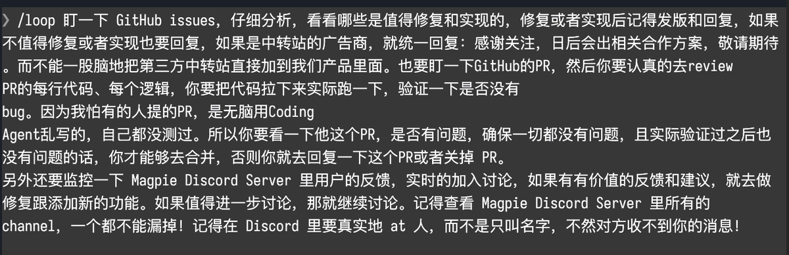
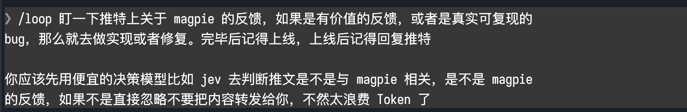

# codex-loop

在 Codex 中重复执行任务：检查部署进度、跟进 CI、处理 PR 反馈，或继续当前会话中未完成的工作。可以指定固定间隔，也可以让 Codex 根据每轮结果决定下一次检查时间。

## 安装

```bash
npx skills add refinist/codex-loop --skill codex-loop -g
```

需要 **Node.js ≥24.0.0**，推荐最新的 **24.x LTS**，支持 **macOS、Linux 和 Windows**。安装后，在 Codex 中通过 `$codex-loop` 调用。

脚本直接使用当前 PATH 中的 `node`，也会跟随 fnm / nvm 当前启用的版本。运行时只使用 Node.js 内置模块，无需在 skill 目录执行 `npm install`，Windows 也不需要额外的时区包。可以先检查版本：

```bash
node --version
```

低于 24 时，启动会提示升级。切换版本后，如果 Codex 仍读取旧环境，请重启 Codex。最低版本是本项目的支持基线，不表示调度算法只能在 24 上实现；版本状态见 [Node.js 官方发布说明](https://nodejs.org/en/about/previous-releases)。

## yetone 的 loop 工作流

[查看 yetone 的原推文](https://x.com/yetone/status/2109855710444237018)

### 原图

以下为 yetone 的推文截图及三张 loop 工作流原图。







## 使用方式

以下示例按 [Claude Code 官方 `/loop` 文档](https://code.claude.com/docs/en/scheduled-tasks)中的部署检查、CI 与评审反馈、默认维护任务场景改写，并适配本项目的 `$codex-loop` 入口和 `.codex/loop.md` 路径。不是 Claude Code 官方实现，也不保证相同的模型判断。

时间间隔和任务内容都可以省略，不同输入对应不同的运行方式：

| 输入 | 示例 | 行为 |
|---|---|---|
| 间隔 + 任务 | `$codex-loop 5m 检查部署进度` | 立即执行一次，之后按固定时间表检查 |
| 只有任务 | `$codex-loop 检查部署进度` | 立即执行一次，每轮结束后决定下次等待时间 |
| 只有间隔 | `$codex-loop 15m` | 按固定时间表执行默认任务 |
| 不带参数 | `$codex-loop` | 以动态间隔执行默认任务 |

### 让 Codex 决定间隔

不指定时间时，Codex 会根据本轮观察，在 **1 分钟到 1 小时**之间选择下一次等待时间，并说明原因。结果即将出现时缩短等待，没有新变化时延长等待。

```text
$codex-loop 检查 CI 是否通过，并处理新的代码评审意见。
```

动态循环会在目标完成、用户取消，或判断继续执行已无帮助时结束。没有固定的默认五分钟间隔。

### 按固定间隔执行

把间隔放在任务前面，或在末尾使用 `every N units`：

```text
$codex-loop 5m 检查部署是否完成，并告诉我结果。
```

```text
$codex-loop 检查部署是否完成，并告诉我结果 every 2 hours
```

支持 `s`（秒）、`m`（分钟）、`h`（小时）和 `d`（天）。固定调度精度为一分钟，秒数向上取整；不能均匀映射到 cron 的间隔会调整并告知，例如 `7m → 6m`、`90m → 2h`。

固定间隔按时间表触发，不是每轮完成后重新等待完整间隔。上一轮尚未结束时不会并发执行，错过多个周期也只补执行一次。实际触发还可能有调度偏移，详见[调度规则](references/behavior.md)。

### 执行默认任务

不提供任务内容时，Codex 会按顺序继续会话中已授权但尚未完成的工作、处理当前分支 PR 的反馈与 CI 问题，再进行范围内的代码检查或简化。

```text
$codex-loop
```

只指定间隔时，也使用默认任务：

```text
$codex-loop 15m
```

### 用 loop.md 自定义默认任务

也可以创建 `loop.md` 自定义默认任务。每轮会重新读取文件，修改后下一轮生效：

| 文件 | 作用范围 |
|---|---|
| `.codex/loop.md` | 当前项目，优先使用 |
| `$CODEX_HOME/loop.md`，默认 `~/.codex/loop.md` | 没有项目配置时使用 |

文件使用普通 Markdown，直接写要重复执行的任务即可。显式提供任务时忽略默认文件；文件内容最多读取 25,000 字节。

例如，在项目中创建 `.codex/loop.md`，写入下面的完整内容。这个小例子改编自官方文档的发布分支 PR 维护场景；将 `release/next` 换成你的实际分支：

```markdown
# 发布分支维护

关注当前仓库 release/next 分支的 PR：

- CI 失败时，检查失败日志，修复原因并运行相关测试。
- 出现新的评审意见时，逐条核对并处理，说明修改和验证结果。
- 只有在本次任务已授权时，才推送改动、回复评论或解决评审讨论。
- 没有新变化时简短说明；需要额外权限或人工决定时，说明阻碍并停止。

每轮结束后判断是否还需要继续，并说明下次检查时间及原因。
```

然后在该项目的 Codex 聊天中启动：

```text
$codex-loop
```

这份文件是一条默认任务，不是多个定时任务的配置清单。若改用 `$codex-loop 15m`，任务内容相同，但触发时间由固定时间表决定，文件中的时间建议不会覆盖它。


### 查看与停止

在聊天中说“列出当前 loop”查看任务，或说“停止这个 loop”取消。固定循环会持续到取消、达到明确的结束条件或七天过期；动态循环每轮决定是否继续。

默认在当前聊天的活跃轮次中执行和等待。停止生成或退出后不会自动唤醒；动态循环需要重新开启，固定任务可在明确请求恢复后继续。`$codex-loop` 是 skill 入口，不会注册 Codex 原生 `/loop` 命令。

如果希望在独立终端中运行，使用附带的 [CLI driver](references/cli.md)。它在前台持有独立的 Codex worker，并在等待结束后恢复该会话；不继承当前聊天的历史。与 Claude Code 的具体差异见[兼容说明](references/compatibility.md)。

### 限制与实现特点

与 [Claude Code 官方说明](https://code.claude.com/docs/en/scheduled-tasks)对照，本项目有以下边界：

| 项目 | codex-loop 的实际行为 |
|---|---|
| 命令入口 | 使用 `$codex-loop`，不能注册原生 `/loop` 命令 |
| 聊天调度 | 占用当前活跃轮次等待；发出最终回复后不能自动唤醒下一轮 |
| 退出与恢复 | 不能接管桌面的停止键或退出事件；固定任务需明确恢复，动态任务需重新启动 |
| 事件监控 | 提供 `wake` 入口，但没有内置后台 Monitor 或自动监听器 |
| 独立 CLI | 使用独立 worker，不继承桌面聊天历史或专属连接器；默认只读，修改项目需配置 `--sandbox workspace-write` |
| 界面与效果 | 没有原生定时任务面板或无变化消息折叠；不保证与 Claude 相同的判断、费用或连续七天运行效果 |

本项目提供的实用功能：

- **跨平台运行**：macOS、Linux、Windows；CI 覆盖三种系统的 Node.js 24.0.0、最新 24.x 和 26.x；无需额外运行依赖。
- **状态可检查**：JSON 状态记录任务 ID、执行次数、下次时间和决策理由，方便排查停止或延迟的原因。
- **CLI 可设置运行边界**：`--max-runs` 限制执行轮数，`--timeout` 限制单轮时间；执行错误或无效决策会阻塞任务，避免盲目重试。
- **调度逻辑可验证**：附带间隔解析、默认文件重载、取消、恢复和跨进程互斥等测试。

这些是本项目可核实的功能，不代表比 Claude 更省 Token 或达到某个产品相似度百分比。更多细节见[兼容说明](references/compatibility.md)和 [CLI 用法](references/cli.md)。
